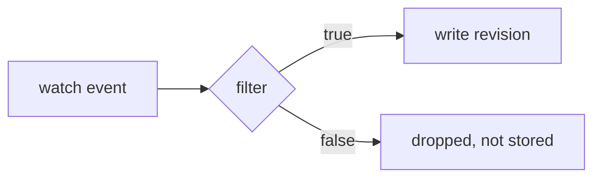

# The filtering model

A filter is a boolean [expr-lang](https://github.com/expr-lang/expr) expression
loog evaluates for every event. It decides what loog pays attention to. The
crucial detail is *when* it runs, which differs between recording and replay.

For the concrete helper list, see the
[Filter expressions reference](../reference/filters.md). For task recipes, see
[Filter what gets recorded](../how-to/filter-resources.md).

## Recording: the filter is a gate

While loog is recording (interactive, headless, or the recorder), the filter
runs **before writing**. An event that does not match is dropped and never
enters the store.

Consequences:

- What you exclude is *gone* from that recording, it is not hidden, it was never
  written. This keeps files small and focused.
- Because the gate runs per event, you can filter on the live event itself, for
  example `Event.Type == "MODIFIED"`.

## Replay: the filter is a view

While browsing an existing file (`loog --replay`), the same flag becomes a
**view**. It hides non-matching objects on screen but never rewrites the file.
Change it freely to focus on different slices of the same capture.

## What you can reference

Every expression has access to:

- **`Object`** — the Kubernetes object as an
  `unstructured.Unstructured`, so its methods work
  (`Object.GetNamespace()`, `Object.GetLabels()`, ...).
- **`Event.Type`** — `ADDED`, `MODIFIED`, or `DELETED` for live events.

Plus the built-in helpers (`Namespaces`, `Names`, `Namespaced`, `Label`,
`LabelExists`, `All`).

!!! note "Historic load uses Object, not Event"
    When loog pre-loads an existing file (on replay, or to show prior history in
    a live session), it applies the filter to each historic object using
    `Object`. `Event` is only populated for live events. Filters that depend on
    `Event.Type` therefore will not match historic revisions, keep the object
    part of your predicate if you need both.

## Why filter at record time

The main reasons to gate at record time rather than "record everything, filter
later":

- **Cost.** Cluster-wide high-churn kinds (Pods, Events, EndpointSlices) produce
  huge volumes. Filtering to the namespaces or names you care about keeps CPU,
  memory, and disk in check.
- **Signal.** A tight recording is faster to browse and easier to hand off.

Start with `All()` to see the shape of the traffic, then tighten.

## See also

- [Filter expressions reference](../reference/filters.md)
- [Filter what gets recorded](../how-to/filter-resources.md)
