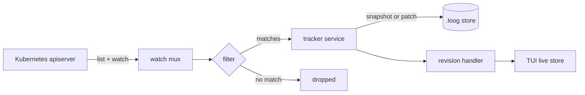

# How loog works

loog has one job: turn a stream of Kubernetes watch events into a browsable
history of object revisions. The same pipeline backs every mode, interactive,
headless, and the in-cluster recorder.

## The pipeline

1. **Watch mux** ([`pkg/mux`](https://github.com/loog-project/loog/tree/main/pkg/mux)).
   For each GVR you ask for, loog starts a dynamic informer and merges all of
   their events (`ADDED` / `MODIFIED` / `DELETED`) into a single channel. Adding
   a GVR blocks until that informer's cache has synced, so you get a complete
   initial picture.
2. **Filter.** Each event is tested against your
   [filter expression](filtering.md). Non-matching events are dropped before
   anything is written.
3. **Tracker service** ([`internal/service`](https://github.com/loog-project/loog/tree/main/internal/service)).
   Decides whether this change becomes a full **snapshot** or a compact
   **patch** against the previous revision, and assigns a revision ID. See
   [Revisions, snapshots and patches](revisions.md).
4. **Store** ([`internal/store`](https://github.com/loog-project/loog/tree/main/internal/store)).
   Persists revisions to a bbolt-backed `.loog` file, optionally s2-compressed.
5. **Revision handler.** In the TUI, the new revision is pushed into an
   in-memory live store that drives the views. In headless mode it is a no-op
   (the file is the product).

## Modes

All modes share steps 1-4; they differ in what sits at step 5 and where the
store lives.

| Mode | Entry point | Store | UI |
|------|-------------|-------|-----|
| Interactive | `loog <gvrs>` | single `.loog` file (temp or `-o`) | TUI, live |
| Headless | `loog -H <gvrs>` | single `.loog` file | none |
| Replay | `loog --replay f.loog` | existing file, read-only | TUI, static |
| Simulate | `loog --simulate` | in-memory generated data | TUI, live |
| Recorder | `loog record <gvrs>` | rotating **segments** in a dir | none (+ HTTP API) |

The recorder swaps the single-file store for a
[segmented store](segments.md) that rolls and prunes files over time; everything
upstream is identical.

## Reconstructing state

Because most revisions are patches, reading history means replaying: start from
a snapshot and apply each subsequent patch to rebuild the object at every point.
loog does this when it loads a file and keeps the reconstructed object per
revision, so any revision can be shown as full YAML, diffed, or exported. The
diff engine lives in
[`pkg/diffmap`](https://github.com/loog-project/loog/tree/main/pkg/diffmap); YAML
rendering and highlighting in
[`pkg/diffpreview`](https://github.com/loog-project/loog/tree/main/pkg/diffpreview).

## Trust and access

loog uses your kubeconfig and RBAC and only ever performs `get`/`list`/`watch`.
It cannot see or change anything your credentials could not already read. In the
[recorder](../how-to/deploy-to-kubernetes.md), that maps to a read-only
ClusterRole.

## See also

- [Revisions, snapshots and patches](revisions.md)
- [The filtering model](filtering.md)
- [Segments, rotation and retention](segments.md)
- [The terminal UI](tui.md)
