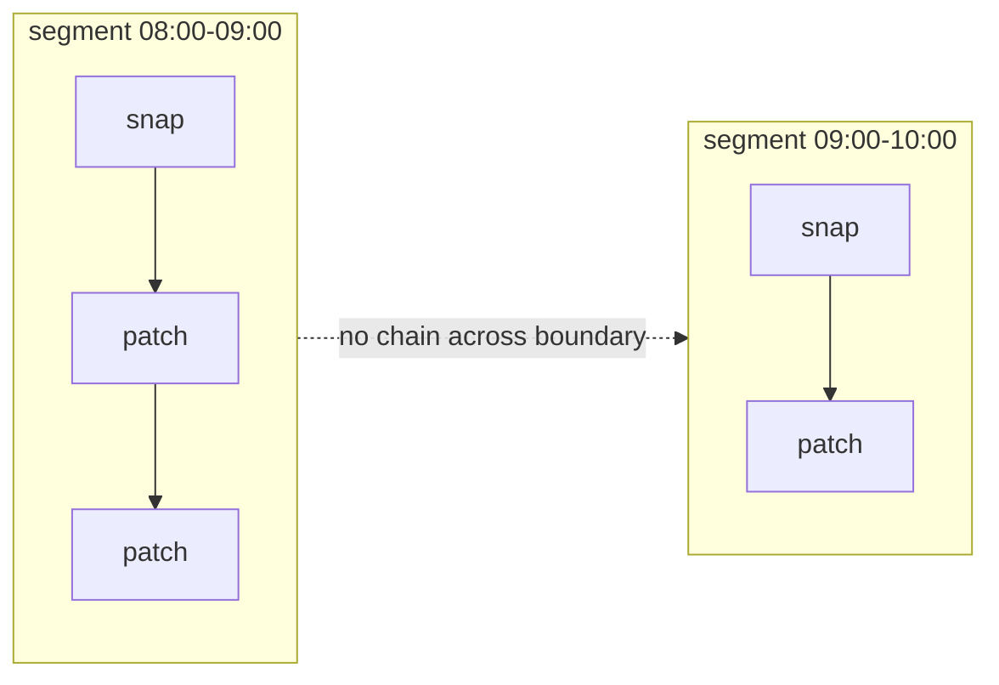

# Segments, rotation and retention

The in-cluster [recorder](../how-to/run-the-recorder.md) does not write one
ever-growing file. It writes a sequence of **segments**, self-contained `.loog`
files that roll on an interval and are pruned after a retention window. This is
what makes a continuous recorder practical: bounded disk use, cheap time-range
retrieval, and clean restarts.

## What a segment is

Each segment is a normal `.loog` store covering a slice of time. Files are named
by their start timestamp so they sort chronologically:

```
/data
├── loog-20260916T080000.000Z.loog   # 08:00 – 09:00
├── loog-20260916T090000.000Z.loog   # 09:00 – 10:00
└── loog-20260916T100000.000Z.loog   # 10:00 – now  (active)
```

The newest file is the **active** segment, the one being written. Older files
are **rolled** (closed, read-only).

## Rotation

Every `--interval`, the recorder closes the active segment and opens a new one.
On rotation it also **resets the tracker cache**, which is the key trick: the
first change to any object in the new segment is written as a full
[snapshot](revisions.md), not a patch against something in the previous file.

That makes every segment **self-contained**: no patch chain ever crosses a file
boundary. A time range can therefore be served by opening only the segments that
overlap it, with no dependency on neighbours.



## Retention and pruning

After each rotation the recorder prunes. Two independent limits, use either or
both:

- **`--retention`** (time) — delete rolled segments whose window ends before
  `now - retention`. `0` keeps everything. Default 30 days.
- **`--max-segments`** (count) — a hard cap; when exceeded, the oldest segments
  are deleted first. Useful as a disk-usage guard. `0` means unlimited.

The active segment is never pruned. Disk usage settles at roughly *change
volume × retention*.

## Restarts and the single-writer rule

- **Single writer.** bbolt takes an exclusive lock on the active segment, so
  exactly one recorder writes to a directory. The Kubernetes Deployment uses
  `replicas: 1` with a `Recreate` strategy for this reason. For HA, use leader
  election, not horizontal scaling.
- **Fresh baseline on restart.** On startup the recorder opens a *new* segment
  rather than resuming the newest one. Informers re-`list` everything, so the
  new segment immediately gets full snapshots of the current world, keeping it
  self-contained. The cost is a brief blind spot only while the recorder is
  actually down.

## Retrieving from segments

Two paths, both clip a `[from, to]` window into one portable file (see
[Retrieve a time range](../how-to/retrieve-a-time-range.md)):

- **`loog fetch`** talks to the recorder's HTTP API. It reads rolled segments
  **and the active one** through the recorder's own open handle, so there is
  **no blind window**, the most recent changes are retrievable immediately.
- **`loog extract`** reads segment files directly from disk. Against a
  copied/offline directory it can only read *rolled* segments, because bbolt
  locks the active file. For the freshest data from a live recorder, prefer
  `fetch`.

Extraction preserves original timestamps and delete markers and rewrites the
window into a single clean snapshot+patch chain, so the result replays exactly
like the original.

## See also

- [Run the always-on recorder](../how-to/run-the-recorder.md)
- [Retrieve a time range](../how-to/retrieve-a-time-range.md)
- [Recorder HTTP API](../reference/http-api.md)
